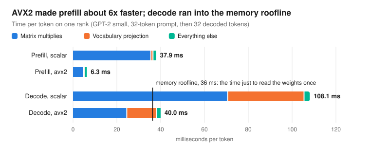
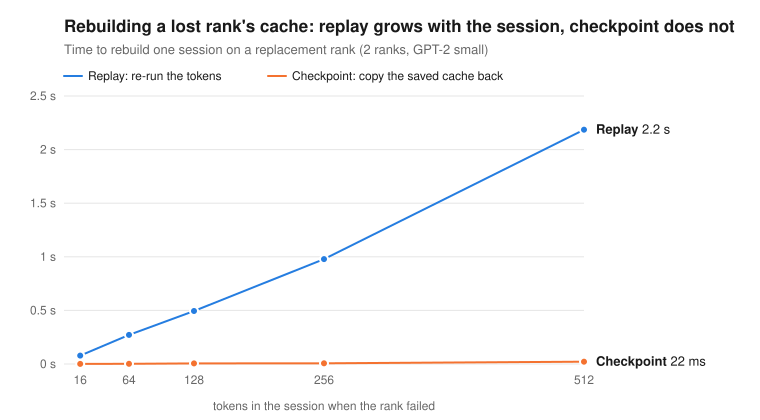

# minirack: a miniature multi-node LLM inference runtime

A from-scratch inference runtime for GPT-2, written in C++ with a Python
front end. Worker processes stand in for the nodes of a rack: each holds one
shard of the model, and they talk to each other over sockets. No ML framework
is used at run time; PyTorch appears only in the tests, as the reference the
output is checked against.

The aim is to work through the problems a real inference runtime has to solve,
at a size that fits on a personal laptop:

- splitting a model across nodes, and moving activations between them
- running only part of the model per token (Mixture of Experts)
- keeping per-request state (the KV cache) on every node
- surviving a node that dies or hangs in the middle of generation
- finding where the time goes, and what the hardware limit is

## Results at a glance

Everything is checked against Hugging Face GPT-2 in PyTorch. Measured on a
4-core laptop (Intel Core i5-10300H). Full tables, method and caveats are in
[docs/RESULTS.md](docs/RESULTS.md).

| | Result |
|---|---|
| Correctness | Logits within 3e-4 of PyTorch in every configuration; greedy text is token-for-token identical |
| Tensor parallelism | One request runs 1.96x faster on 2 ranks and 2.75x faster on 4 |
| Mixture of Experts | Running 2 of 8 experts per token is 1.5x faster; every routing decision matches a PyTorch reference |
| KV cache | Bit-identical to recomputing from scratch; the 65th token takes 40 ms instead of 517 ms |
| Failure recovery | `kill -9` a rank mid-generation: the output is bit-identical and the client sees no error. With a standby and checkpoints that step takes 42 ms instead of 38 to 40 |
| AVX2 kernels | Prefill 8.8x faster (11 to 119 tokens/s on one rank, 250 on two). Decode 2.9x faster on one rank |
| Memory roofline | The laptop reads about 15 GB/s from memory in total and a decoded token needs 495 MB, a floor near 33 ms. Measured: 43.9 ms on one rank, 38.5 ms on two |





## What the project covers

| Area | What is built and measured | Part |
|------|----------------------------|------|
| Model internals | The GPT-2 forward pass in plain C++: attention, MLP, layer normalisation, weight tying | 1 |
| Distributed execution | A layer-wise pipeline split, then tensor parallelism with hand-written collectives (broadcast, all-reduce, gather) over TCP | 1, 2 |
| Sparse models | A Mixture-of-Experts layer: router, top-k, gates, running only the chosen experts, experts sharded across ranks | 3 |
| Stateful serving | Sessions with a KV cache held on every rank, separate prefill and decode paths, limits and cleanup | 4 |
| Fault tolerance | Crash and hang detection, fencing, abort and resynchronise, replay against checkpoint recovery, warm standbys, a supervisor | 5 |
| Performance engineering | Profiling, AVX2 + FMA kernels with run-time dispatch, cache behaviour, the memory roofline | 6 |
| Testing method | A PyTorch reference, exact-equality invariants, anchor tests, forced failures, conservation checks | all |

## Learning outcomes

Seven things the project demonstrates, each backed by a measurement in
[docs/RESULTS.md](docs/RESULTS.md):

1. **Where you cut the model decides what you gain.** Cutting between layers
   buys memory and throughput but does not speed up one request, because the
   workers take turns. Cutting inside each layer lets them work at the same
   time: 1.96x on two ranks.
2. **Copies of the same state must agree to the last bit.** Floating-point
   sums depend on order, so the ranks' partial results are added in one place
   and one order, and every request ends with a check that all copies match.
3. **Routing is a cliff.** A Mixture-of-Experts router makes hard choices, so
   a difference in the last bit can send a token to a different expert. That
   is one more reason the copies must be identical.
4. **A cache that is exact is worth more than one that is close.** Decoding
   with the KV cache gives bit-identical output to recomputing everything.
   That property is what later makes recovery by replay exact.
5. **Recovery is three separate problems:** noticing, replacing and
   rebuilding. Each has a cheap answer and a fast one. With the fast ones a
   killed rank costs the client about 2 ms.
6. **Prefill is limited by arithmetic, decode by memory.** The same AVX2
   kernel made prefill 8.8x faster and decode 2.9x. A decoded token must read
   every weight once, and all the cores of one machine share the same memory:
   one process reads 15.7 GB/s, two get 7.1 GB/s each. So a second rank on
   the same machine nearly halves prefill and barely moves decode.
7. **Benchmarks need checking too.** The first memory test reported
   10.8 GB/s while the kernel was reading at 15.8 GB/s. A limit that the code
   beats is not a limit, and the test was rebuilt.

## How it works, part by part

**Part 1, pipeline split (`mr_worker`).** Cut between layers. Workers take turns.

```
client --tokens--> worker 0 ----hidden [T x 768]----> worker 1
                   embed + layers 0-5                 layers 6-11 + head
client <--logits-- worker 0 <-------logits----------- worker 1
```

**Part 2, tensor parallelism (`mr_rank`).** Cut inside every layer. All ranks
work on the same layer at the same time, each on its own slice of the weights,
and combine their partial results with an all-reduce.

```
                  +--> rank 0: heads 0-5,  MLP units 0-1535    --+
 hidden state h --+                                              +--> all-reduce (sum) --> next layer
 (same on all)    +--> rank 1: heads 6-11, MLP units 1536-3071 --+
```

**Part 3, Mixture of Experts (`mr_rank --moe`).** The MLP becomes 8 small
experts. A router picks the best 2 for each token, and only those run. Each
rank owns some of the experts.

```
                         +--> rank 0 owns experts 0-3: runs the ones chosen, on the tokens that chose them --+
 token --> router: top 2 +                                                                                   +--> all-reduce
                         +--> rank 1 owns experts 4-7: same                                                  --+
```

The MoE here reuses GPT-2's weights (expert e is a group of GPT-2's MLP hidden
units) with a random, untrained router. It does not produce sensible text. It
exists to build and test the runtime side of MoE: routing, running only the
chosen experts, and the uneven load that results.

**Part 4, KV cache (`prefill` / `decode` / `release`).** Each token's keys and
values are computed once and kept, so a new token costs one token of work
instead of re-running the whole text. Each rank keeps the cache for its own
attention heads.

```
 prefill "Hello, my dog is"  --> run 4 tokens once, store their keys and values (a session)
 decode  " cute"             --> run 1 token: append its key and value, attend over the 5 stored
 decode  "."                 --> run 1 token: append, attend over the 6 stored
 release                     --> free the session on every rank
```

**Part 5, failure recovery.** A rank is killed or freezes while text is being
generated. The root notices, cancels the half-done step on the surviving
ranks, takes in a replacement, rebuilds the lost cache, and runs the step
again. The client sees a pause, no error, and exactly the same output.

```
 rank 1 dies       root notices: socket      replacement:         cache rebuilt:        the interrupted
 or hangs     -->  closed, or silent    -->  a waiting standby,   replay the tokens, --> step runs again
                   past the timeout          or a new process     or copy a checkpoint
```

**Part 6, kernels and profile.** Measure where the time goes, rewrite the
hot loops with AVX2, measure again. Prefill, where weights are reused for
many tokens while they sit in the CPU cache, became about 9x faster. Decode,
where one token has to read every weight once, became about 3x faster and
then ran into a wall that no arithmetic trick moves: the speed at which the
machine can read memory, which all its cores share.

```
 time per decoded token  >=  bytes of weights read per token  /  memory read speed
                               495 MB                          /  about 15 GB/s    =  about 33 ms
 measured: 43.9 ms on one rank; 32.5 ms of compute (38.5 ms in all) on two
```

## Requirements

- Linux (on Windows, use WSL2). The networking code uses POSIX sockets.
- g++ with C++17, CMake 3.16+
- Python 3 with numpy
- For the correctness checks only: `pip install torch transformers`

## Quick start

```bash
# 1. Build
cmake -S . -B build && cmake --build build -j

# 2. Get GPT-2 small (124M) from Hugging Face and convert it
mkdir -p weights/gpt2 && cd weights/gpt2
curl -LO https://huggingface.co/openai-community/gpt2/resolve/main/config.json
curl -LO https://huggingface.co/openai-community/gpt2/resolve/main/model.safetensors
# optional, only for scripts/generate.py (text in, text out):
for f in vocab.json merges.txt tokenizer.json; do
  curl -LO https://huggingface.co/openai-community/gpt2/resolve/main/$f
done
cd ../..
python3 scripts/export_weights.py --safetensors weights/gpt2/model.safetensors \
    --config weights/gpt2/config.json --out weights/gpt2.mrkw

# 3. Check against PyTorch (each script starts and stops its own processes)
python3 tests/check_part1.py --weights weights/gpt2.mrkw --hf-dir weights/gpt2
python3 tests/check_part2.py --weights weights/gpt2.mrkw --hf-dir weights/gpt2
python3 tests/check_part3.py --weights weights/gpt2.mrkw --hf-dir weights/gpt2
python3 tests/check_part4.py --weights weights/gpt2.mrkw --hf-dir weights/gpt2
python3 tests/check_part5.py --weights weights/gpt2.mrkw --hf-dir weights/gpt2
python3 tests/check_part6.py --weights weights/gpt2.mrkw --hf-dir weights/gpt2
scripts/run_all_checks.sh weights/gpt2.mrkw weights/gpt2    # or: build and run all six

# Or run a rack by hand
scripts/run_local.sh weights/gpt2.mrkw        # Part 1: 2-worker pipeline
scripts/run_local_tp.sh weights/gpt2.mrkw 2   # Part 2: 2 tensor-parallel ranks

# Part 3: make an MoE file (8 experts, top-2), then run 2 ranks with it
python3 scripts/make_moe.py --base weights/gpt2.mrkw --experts 8 --top-k 2 --seed 8 --out weights/moe8.mrkw
scripts/run_local_tp.sh weights/gpt2.mrkw 2 weights/moe8.mrkw

# Part 4: with a (dense) rack running, generate text from another terminal
python3 scripts/generate.py --hf-dir weights/gpt2 --prompt "Hello, my dog is cute" --tokens 30

# Part 5: kill a rank mid-generation and compare with an undisturbed run (one command)
python3 scripts/demo_failover.py --weights weights/gpt2.mrkw --hf-dir weights/gpt2
python3 scripts/demo_failover.py --weights weights/gpt2.mrkw --hf-dir weights/gpt2 --recovery replay --no-standby
python3 scripts/demo_failover.py --weights weights/gpt2.mrkw --hf-dir weights/gpt2 --hang

# Or keep a rack running under the supervisor, generate from another terminal, and `kill -9` a rank yourself
python3 scripts/supervisor.py --weights weights/gpt2.mrkw --nranks 2 --standby --recovery checkpoint

# Part 6: kernel tests, the microbenchmark, and the same rack with the old scalar loops
build/mr_kernel_test
build/mr_bench
MR_KERNELS=scalar scripts/run_local_tp.sh weights/gpt2.mrkw 2
python3 scripts/plot_profile.py && python3 scripts/plot_recovery.py   # redraw the charts from your own run
```

## Documentation

| Document | What is in it |
|----------|---------------|
| [docs/ARCHITECTURE.md](docs/ARCHITECTURE.md) | Processes, the wire protocol, how a request flows, what state lives where, and how failures are handled |
| [docs/RESULTS.md](docs/RESULTS.md) | Every check and every measurement, part by part, with how to read them |
| [docs/README.md](docs/README.md) | Index of the six sets of notes: the concepts each part uses, the design decisions and what each one cost, and questions to test your understanding |
| [docs/data/](docs/data/) | Raw output of the runs the numbers come from, and the data behind the two charts |

## Limits, and where the measurements point next

- The root is a single point of failure, and it serves one client at a time.
- Decode is limited by memory, so the next gain there is fewer bytes per
  token: 16-bit or 8-bit weights would halve or quarter what each token
  reads. Batching several sessions through one pass over the weights would
  share that cost between them.
- One rank's decode is still 1.4x above its memory floor, for a reason not
  yet found.
- Ranks on one machine share its memory. Running the ranks on separate
  machines, each with its own memory, is the test this project has not done.
- A decode step makes 27 round trips to the root, about 6 ms here. Fewer,
  larger exchanges per step would cut that.
- GELU is the next hotspot in prefill (14%).
- Every message goes through the root. With more ranks a ring or tree
  all-reduce would spread that load.
- Experts are placed on ranks in fixed ranges. Placing them by measured load
  would even out the 61% / 39% split seen in Part 3.
- The Mixture-of-Experts router is random and untrained: that model exists to
  exercise the runtime, not to produce sensible text.
- The AVX2 kernels need an x86-64 CPU with AVX2 and FMA. Elsewhere the scalar
  kernels are used automatically.

## Layout

```
src/mat.h          float32 matrix
src/ops.*          linear, matmul, layernorm, GELU, causal attention
src/weights.*      .mrkw weight file reader (whole tensors or row slices)
src/net.*          sockets and the framed wire protocol
src/model.*        Part 1 shard: embedding? + layers A..B + head?
src/worker.cpp     Part 1 process: one stage of the pipeline
src/mesh.*         Part 2 collectives: broadcast, all-reduce, gather, replica check; Part 5 abort and rejoin
src/tp_model.*     Part 2 shard: a slice of every layer
src/moe.*          Part 3 router, top-k, gates, and sparse expert execution
src/kernels.*      Part 6 the hot loops: scalar versions, and run-time choice of implementation
src/kernels_avx2.cpp   Part 6 the AVX2 + FMA versions (the only file built with -mavx2 -mfma)
src/prof.*         Part 6 per-operation timers
src/bench.cpp      Part 6 microbenchmark: kernel speed hot and cold, memory read speed
src/kernel_test.cpp    Part 6 kernel unit tests
src/kv_cache.*     Part 4 sessions, the KV cache, and attention that uses it
src/exec.*         the program every rank runs for one request
src/root.cpp       rank 0: front door, event loop, and Part 5 failure recovery
src/rank.cpp       main(), options, and the loop of every non-root rank
scripts/           weight export, MoE file generator, Python client, text generation demo,
                   supervisor, failover demo, chart scripts, local launchers, run_all_checks.sh
tests/             correctness checks against PyTorch
docs/              ARCHITECTURE.md, RESULTS.md, the notes for each part (concepts used and
                   decisions taken), the two charts, and docs/data/ with the raw run output
```

## License

MIT. See [LICENSE](LICENSE).
