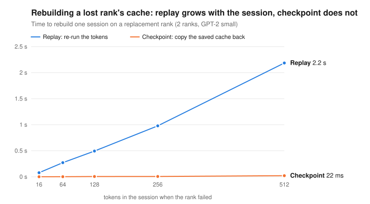
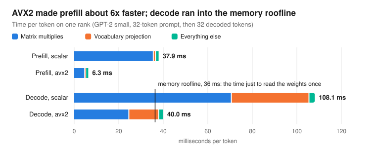

# Results

Every check and measurement behind the summary in the [README](../README.md).
The concepts and design decisions of each part are in the [notes](README.md).

All numbers are from one machine: a laptop with an Intel Core i5-10300H
(4 cores, 8 threads, 8 MB cache), running Ubuntu 24.04 under WSL2 with
g++ 13.3 and 7.6 GB of memory available. The raw output of the runs is in
[`data/`](data/). Run the checks on your own machine for your own numbers;
`build/mr_bench` in particular depends on your CPU's caches and memory. The
reference is Hugging Face `GPT2LMHeadModel` on the same weights, over six
token sequences of length 1 to 32.

Everything runs with the AVX2 kernels unless a table says otherwise; they are
the default on a CPU that has them. Part 6 compares them with the scalar
kernels the project started with, and `MR_KERNELS=scalar` runs any part that
way. Timings move by a few percent between runs.

## Part 1: pipeline split

| Check | Result |
|-------|--------|
| Largest logit difference vs PyTorch, any position, any split | 2.3e-4 |
| Next-token prediction (argmax) matches PyTorch | every position |
| 2- and 3-worker output vs 1-worker output | bit-identical |
| Bad requests (out-of-range token, empty, too long) | error reply, workers keep serving |

A 32-token request with logits for every position took 502 ms on one worker,
745 and 477 ms on the two 2-worker splits, and 568 ms on three workers: no
trend. A pipeline split does not make one request faster, because the workers
take turns. What it buys is memory (a model too big for one node) and, once
several requests are in flight, throughput.

## Part 2: tensor parallelism

| Check | Result |
|-------|--------|
| Largest logit difference vs PyTorch, 1 to 4 ranks | 2.1e-4 |
| Next-token prediction (argmax) matches PyTorch | every position |
| Same request twice | bit-identical |
| All ranks hold a bit-identical hidden state | checked on every request |
| One rank corrupts its hidden state (forced in the test) | caught by the replica check |
| One rank is killed and nothing replaces it | client gets an error reply after the configured wait, no hang |

Latency of one 32-token request (last-position logits, best of 5):

| Ranks | Latency | Speedup | Time in collectives (root) | Data through the root |
|-------|---------|---------|----------------------------|-----------------------|
| 1 | 273 ms | 1.00x | 0 ms | 0 MB |
| 2 | 139 ms | 1.96x | 5 ms | 4.9 MB |
| 3 | 129 ms | 2.12x | 29 ms | 9.8 MB |
| 4 | 99 ms | 2.75x | 15 ms | 14.6 MB |

How to read this:

- Two ranks answer one request 1.96x faster. The 27 collectives of a request
  moved 4.9 MB and cost about 4% of the time.
- Four ranks on four cores give 2.75x, not 4x. The causes are not separated
  here. Candidates: every message passes through the root (its data triples
  from 2 to 4 ranks), a laptop lowers its clock speed when all cores are
  busy, and the ranks share one memory system, which Part 6 measures.
- "Time in collectives" includes waiting for a rank that has not finished its
  part, not only copying bytes.
- Memory: with 2 ranks, the root holds 328 MB of weights and rank 1 holds
  247 MB, against 498 MB for the whole model. The root is larger because it
  keeps the full token table for embedding.

## Part 3: Mixture of Experts

Two references are used. The anchor (8 experts, top-8, every gate equal to 1)
is mathematically GPT-2's own MLP, so it is compared with plain Hugging Face
GPT-2. The real MoE (8 experts, top-2, softmax gates) is compared with a
PyTorch MoE model: Hugging Face GPT-2 with each MLP replaced.

| Check | Result |
|-------|--------|
| Anchor vs plain GPT-2, 1 / 2 / 4 ranks: largest logit difference | 1.3e-4 |
| MoE vs PyTorch MoE reference, 1 to 4 ranks: largest logit difference | 1.4e-4 |
| Next-token prediction (argmax) matches | every position |
| Tokens per expert reported by the rack vs the reference | identical |
| (token, expert) pairs executed across all ranks | exactly layers x tokens x k |
| Same request twice | bit-identical |

Latency of one 32-token request (last-position logits, best of 5):

| Model | Ranks | Latency | Compute per rank | Expert work per rank |
|-------|-------|---------|------------------|----------------------|
| Dense | 1 | 256 ms | 256 ms | - |
| Dense | 2 | 138 ms | 133 / 129 ms | - |
| MoE top-2 of 8 | 1 | 166 ms | 166 ms | 100% |
| MoE top-2 of 8 | 2 | 118 ms | 103 / 90 ms | 61% / 39% |

How to read this:

- MoE is 1.54x faster than dense on one rank. Each token runs 2 of 8 experts,
  so the MLP does a quarter of the arithmetic, and the MLP is about two
  thirds of a layer's arithmetic. That alone would give about 2x, and with
  the scalar kernels it nearly does (1.8x, from the Part 6 table). With the
  AVX2 kernels the matrix multiplies are fast enough that what MoE does not
  shrink (the vocabulary projection, GELU, routing, gathering and scattering
  tokens) is a larger share.
- MoE on two ranks is 1.40x faster than on one, where dense reaches 1.86x.
  The reason is load balance. The router sent 61% of the expert work to
  rank 0's experts, and the all-reduce makes everyone wait for the busiest
  rank.
- Tokens per expert for this request were 104, 173, 106, 89, 58, 59, 101, 78.
  Expert 1 got three times the load of expert 4.

Known limits at this stage: the router is random and untrained (see above),
experts are assigned to ranks as fixed contiguous ranges rather than by load,
and each rank still sends a full-size matrix to the all-reduce even when most
of its rows are zero.

## Part 4: KV cache

| Check | Result |
|-------|--------|
| Prefill + 12 decode steps vs re-running with no cache (dense on 1, 2, 4 ranks; MoE on 2) | bit-identical at every step |
| The same logits vs PyTorch | largest difference 1.5e-4 |
| Two sessions advanced in alternation vs each alone | bit-identical |
| Wrong uses (unknown session, duplicate id, bad token, too long, use after release) | error reply; the open session is left intact |
| Client disconnects without releasing | the rack frees its sessions on every rank |
| Session limit (64) | enforced |
| 24 greedy tokens vs Hugging Face `generate` | identical tokens |

Timing for a 32-token prompt followed by 32 decoded tokens:

| Model | Ranks | Prefill | Decode per token | of which head | In collectives | Data per step | Same token, no cache |
|-------|-------|---------|------------------|---------------|----------------|---------------|----------------------|
| Dense | 1 | 320 ms | 40.0 ms | 13.2 ms | 0 ms | 0 kB | 517 ms |
| Dense | 2 | 165 ms | 37.0 ms | 10.7 ms | 5.5 ms | 151 kB | 290 ms |
| MoE top-2 of 8 | 2 | 88 ms | 25.8 ms | 9.5 ms | 6.0 ms | 151 kB | 169 ms |

How to read this:

- The cache makes token 65 about 13x cheaper on one rank (40 ms instead of
  517 ms), and the gap widens with every token generated.
- A session of 64 tokens holds 4.7 MB of keys and values in total, split
  across the ranks by attention head.
- A decoded token costs about 4x what a prefill token costs (40 ms against
  10 ms) for the same arithmetic. Part 6 measures why: in prefill a few rows
  of a weight matrix are reused for a whole block of tokens while they sit in
  the CPU cache, but a single decoded token has to pull all 495 MB of weights
  from main memory once.
- A second rank nearly halves prefill (320 to 165 ms) but barely moves decode
  (40.0 to 37.0 ms). Part 6 measures why as well: ranks on one machine share
  its memory.
- Communication is 15% of a dense decode step and 23% for MoE. The messages
  are small (27 collectives of about 3 kB each way), but so is the compute
  per step.
- Picking the next token on the rack sends 8 bytes per rank instead of that
  rank's slice of the logits: 151 kB per step instead of 252 kB. The time was
  about the same (37.0 against 37.8 ms per token).

## Part 5: failure recovery

Every scenario is run twice, once undisturbed and once with a failure, and the
logits must be bit-identical with no error reaching the client.

| Scenario | Result |
|----------|--------|
| Rank killed between two steps, two sessions open (replay and checkpoint) | both sessions continue, bit-identical |
| Rank killed in the middle of a prefill or a decode step (2 ranks) | step is run again, bit-identical |
| The same with 3 ranks, killing either non-root rank | the surviving rank drops the half-done step, falls back in step, bit-identical |
| Rank frozen with SIGSTOP (root timeout 1000 ms) | found by timeout, standby takes over, bit-identical; the frozen process exits by itself when woken |
| Rank killed and nothing replaces it | clear error after the configured wait; nothing half-applied; the session carries on once a replacement arrives |
| Three failures during one generation | bit-identical |
| Under the supervisor, killed at token 9 of 24 | text identical to Hugging Face `generate` |
| Mixture-of-Experts model | bit-identical |

What the client sees on the step that hits the failure (64-token session,
2 ranks; a normal step is 38 to 40 ms):

| Replacement | State rebuilt by | That step | of which waiting for a rank | of which rebuilding |
|-------------|------------------|-----------|-----------------------------|---------------------|
| new process (loads its weights) | replay | 697 ms | 299 ms | 357 ms |
| new process (loads its weights) | checkpoint | 316 ms | 268 ms | 1.6 ms |
| standby (weights already loaded) | replay | 354 ms | 0 ms | 316 ms |
| standby (weights already loaded) | checkpoint | 42 ms | 0 ms | 1.3 ms |

Time to rebuild one session on the replacement rank (charted below):

| Tokens in the session | Replay | Checkpoint | Checkpoint copies |
|-----------------------|--------|------------|-------------------|
| 16 | 78 ms | 0.6 ms | 0.6 MB |
| 64 | 271 ms | 1.7 ms | 2.4 MB |
| 128 | 494 ms | 5.8 ms | 4.7 MB |
| 256 | 979 ms | 6.7 ms | 9.4 MB |
| 512 | 2186 ms | 21.7 ms | 18.9 MB |

How to read this:

- With a standby and checkpoints, a `kill -9` between two steps costs the
  client about 2 ms: that step took 42 ms against a normal 38 to 40. If the
  kill lands in the middle of a step, the step is run again, so it costs
  about one extra step. With neither a standby nor checkpoints it costs
  0.7 s, and that grows with the session.
- Replay rebuilds at about 4 ms per token, so its cost follows the session
  length: 2.2 s at 512 tokens. Checkpoint copies bytes back: 22 ms at 512
  tokens, about 100 times faster.
- Checkpointing is not free. Every decode step ships 37 kB more (188 kB
  instead of 151 kB, 24% more), and the root holds a second copy of the other
  ranks' cache (37 kB per token here). Step time was the same with either
  strategy: 38.7 and 38.6 ms.
- A crash is noticed at once, because the dead process's socket closes. A
  frozen process keeps its socket open, so only the timeout reveals it: with
  a 1000 ms timeout that step took 1213 ms.
- Exactness comes from Part 4. Replay works because prefill and step-by-step
  decode build bit-identical caches, so re-running the tokens recreates
  exactly what was lost.
- Replay is a prefill, so its speed follows the kernels. These numbers are
  with the AVX2 kernels; with the scalar ones a prefill is about 9 times
  slower on this machine (Part 6).

Known limits of the recovery: the root itself is a single point of failure
(it holds the client connections, the token history and the checkpoints). A
frozen rank is only noticed while a request is running. The timeout must be
longer than the slowest legitimate step, and a rank that is merely slow past
it is replaced although it was healthy. Without a standby the supervisor
cannot replace a frozen process, because it never exits. If the replica check
fails (silent corruption) the rack still stops rather than repairs itself.

## Part 6: AVX2 kernels, the profile, and the memory roofline

| Check | Result |
|-------|--------|
| Kernel unit tests: AVX2 against scalar on 15 awkward shapes (sizes that are not multiples of 8 or 4, single rows, empty inputs) | agree to the last few bits |
| Batch invariance: T tokens in one call against one call per token, every kernel | bit-identical |
| End to end with each kernel set: against PyTorch, cached against recomputed, greedy text against Hugging Face | within 2.9e-4; bit-identical; identical |
| Mixture of Experts with each kernel set | every routing decision still matches the reference |
| A scalar rank tries to join an AVX2 rack | refused |
| All checks of Parts 1 to 5, run with the AVX2 kernels | pass |

Before and after (32-token prompt, then 32 decoded tokens; a 256-token prompt
for the throughput column):

| Model | Ranks | Kernels | Prefill, 32 tokens | Decode per token | Prefill throughput |
|-------|-------|---------|--------------------|------------------|--------------------|
| Dense | 1 | scalar | 2246 ms | 125.7 ms | 11 tokens/s |
| Dense | 1 | AVX2 | 257 ms | 43.9 ms | 119 tokens/s |
| | | speedup | 8.8x | 2.9x | 10.7x |
| Dense | 2 | scalar | 1090 ms | 66.3 ms | 27 tokens/s |
| Dense | 2 | AVX2 | 136 ms | 38.5 ms | 250 tokens/s |
| | | speedup | 8.0x | 1.7x | 9.3x |
| MoE top-2 of 8 | 2 | scalar | 616 ms | 51.2 ms | 48 tokens/s |
| MoE top-2 of 8 | 2 | AVX2 | 87 ms | 27.2 ms | 438 tokens/s |
| | | speedup | 7.1x | 1.9x | 9.1x |

An earlier run of the same check agreed within a few percent (for example
255 ms and 46.0 ms for the AVX2 one-rank row).

Where one rank's time goes (dense, one rank, milliseconds per token):

| | Matrix multiplies | Vocabulary projection | GELU | Attention | Other | Total |
|---|---|---|---|---|---|---|
| Prefill, scalar | 66.89 | 1.74 | 1.14 | 0.31 | 0.10 | 70.19 |
| Prefill, AVX2 | 6.41 | 0.34 | 1.09 | 0.07 | 0.10 | 8.02 |
| Decode, scalar | 69.98 | 52.97 | 1.15 | 1.27 | 0.37 | 125.73 |
| Decode, AVX2 | 27.38 | 13.62 | 1.69 | 0.66 | 0.52 | 43.86 |

The matrix kernel on its own (`build/mr_bench`, one 768 x 3072 matrix,
billions of multiply-adds per second):

| Kernel | Weights in cache, 32 tokens per pass | Weights in cache, 1 token | Every weight read once |
|--------|--------------------------------------|---------------------------|------------------------|
| scalar | 1.29 | 1.29 | 1.28 |
| scalar, loops reordered | 1.52 | 1.33 | 1.22 |
| AVX2 | 10.81 | 5.44 | 3.41 |

Reading weights in several processes at the same time (the decode pattern,
AVX2 kernel):

| Processes | Each one reads | All together |
|-----------|----------------|--------------|
| 1 | 15.7 GB/s | 15.7 GB/s |
| 2 | 7.1 GB/s | 14.1 GB/s |
| 4 | 3.7 GB/s | 14.9 GB/s |

The memory roofline for decode:

| Model | Ranks | Weights read per token, per rank | Read speed per rank | Time just to read them | Measured compute | Measured / roofline |
|-------|-------|----------------------------------|---------------------|------------------------|------------------|---------------------|
| Dense | 1 | 495 MB | 15.8 GB/s | 31.4 ms | 43.9 ms | 1.40x |
| Dense | 2 | 247 MB | 7.1 GB/s | 35.0 ms | 32.5 ms | 0.93x |
| MoE top-2 of 8 | 2 | 162 MB (average) | 7.1 GB/s | 22.9 ms | 21.7 ms | 0.95x |

Compute against communication (dense, 2 ranks, AVX2): copying messages took
6.8 ms of a 136.5 ms prefill (5%) and 5.8 ms of a 38.5 ms decode step (15%).
With the scalar kernels the shares were 1% and 5%.

How to read this:

- **Prefill is limited by arithmetic, so SIMD pays in full.** With the
  weights in cache the AVX2 kernel does 10.8 billion multiply-adds per second
  against 1.3 for the scalar loop, 8 times more. End to end that is 8.8x for
  a 32-token prompt and 10.7x for a 256-token one.
- **Decode is limited by memory.** One decoded token must read every weight
  once, 495 MB, and nothing is reused. In that situation the same AVX2 kernel
  manages 3.4 billion multiply-adds per second, a third of its in-cache
  speed.
- **The whole laptop moves about 15 GB/s from memory, however many processes
  share it.** One process reads 15.7 GB/s. Two get 7.1 GB/s each, four get
  3.7 GB/s each. So a dense decode step, which needs 495 MB, cannot take much
  less than about 33 ms on this machine, with any number of ranks.
- **That is why a second rank nearly halves prefill but barely helps
  decode.** Prefill goes from 257 to 136 ms, because it needed more
  arithmetic and got a second core. Decode goes from 43.9 to 38.5 ms: its two
  ranks compute for 32.5 ms, which is the floor, and then pay 5.8 ms for
  messages. A second core on the same memory brings no second memory.
- **On a real rack every node has its own memory**, so this limit applies to
  each node separately, and spreading decode across machines does help. A
  cloud server used during development showed the other side of this: there
  two processes still read 13 GB/s each, and the second rank halved decode
  time.
- **Ratios under 1 in the roofline table mean "at the limit".** The read
  speed and the decode time come from separate measurements.
- **One rank alone is 1.4x above its floor, and that gap is not explained.**
  During a real decode step a single rank reads about 11 GB/s, against
  15.7 GB/s in the benchmark.
- **Reading fewer bytes per token is what helps decode.** The
  Mixture-of-Experts model reads only the chosen experts, 324 MB per token
  instead of 495, and decodes in 27.2 ms against 38.5.
- **Reordering the loops helped the scalar kernel a little** (1.52 against
  1.29 with 32 tokens per pass, and 1.27 against 1.19 in an earlier run).
  The 9.4 MB matrix is larger than this CPU's 8 MB cache, so reusing each row
  for a block of tokens saves some trips to memory even at scalar speed.
- **What was not rewritten is now visible.** GELU was 1.6% of a prefill token
  and is 14% after the speedup. It was left as it is because a vector version
  needs an approximation of `tanh`, and this project keeps exact agreement
  with the standard library.
- **Communication tripled its share.** Copying messages is now 15% of a
  decode step. A step makes 27 round trips to the root whatever the model
  size, about 6 ms here. On hardware where the arithmetic takes microseconds,
  those round trips would be most of the step.

Design rules the kernels keep: the result for one token never depends on the
other tokens in the batch (that is what keeps decode equal to prefill, and
replay exact), only one file is compiled with AVX2 flags and it is entered
only after a run-time check of the CPU, and a rack refuses to mix kernel
sets, because a replacement rank must reproduce the arithmetic of the rank it
replaces.
